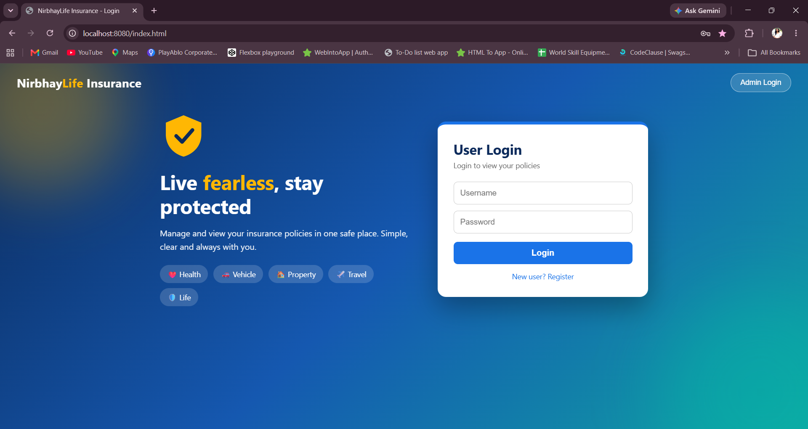
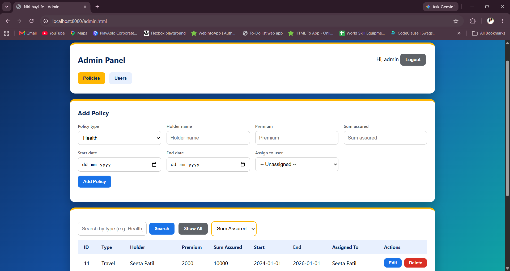
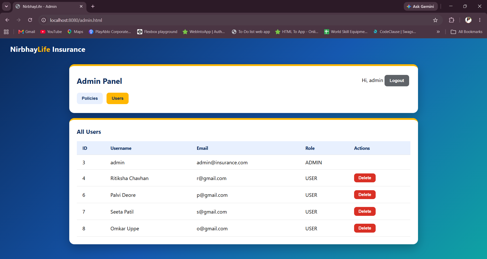
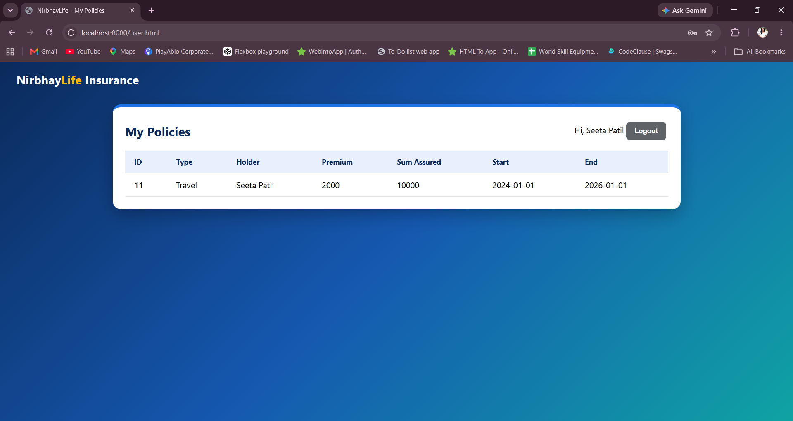

# Nirbhay Life - Policy Management System

> *Nirbhay* means "fearless". Insurance lets people live without the fear of loss.

A role-based insurance policy management web application built with **Spring Boot**. An admin manages users and policies, and each user can view only their own policies.

## Features
- **Admin:** create, view, edit, delete policies; search by type; sort; assign a policy to a user; view and delete users
- **User:** register, login, and view only their own policies (read-only)
- Role-based access control (ADMIN / USER) enforced on the server with Spring Security
- Passwords stored as BCrypt hashes
- Validation and global exception handling
- Unit tests with JUnit and Mockito
- Simple responsive UI (HTML, CSS, JavaScript)

## Tech Stack
Java 17, Spring Boot, Spring Data JPA (Hibernate), Spring Security, MySQL, Maven, JUnit 5, Mockito, HTML/CSS/JavaScript

## Screenshots
| Login | Admin - Policies |
|---|---|
|  |  |

| Admin - Users | User - My Policies |
|---|---|
|  |  |

## Database Design
- `users` (id, username, password, email, role)
- `policy` (id, policy_type, holder_name, premium, sum_assured, start_date, end_date, user_id)
- Relationship: one user can have many policies (`@ManyToOne` from Policy to User)

## API Endpoints
| Method | URL | Access |
|---|---|---|
| POST | /auth/register | Public |
| GET | /auth/me | Logged-in user |
| GET | /policies/my | Logged-in user (own policies) |
| GET, POST | /policies | Admin |
| GET, PUT, DELETE | /policies/{id} | Admin |
| GET | /policies/type/{type} | Admin |
| GET | /policies/sort/{field} | Admin |
| GET | /users | Admin |
| DELETE | /users/{id} | Admin |

## How to Run
1. Install JDK 17, Maven and MySQL.
2. Create the database:
   ```sql
   CREATE DATABASE insurance_db;
   ```
3. Create a file `local.properties` in the project root:
   ```properties
   spring.datasource.password=YOUR_MYSQL_PASSWORD
   app.admin.password=Admin@123
   ```
4. Run the app (`InsuranceApplication`) or use `mvn spring-boot:run`.
5. Open http://localhost:8080
6. Admin login (top right): `admin` / the password you set above. New users can register from the login page.

## Future Improvements
- JWT-based authentication instead of HTTP Basic
- Forgot / reset password
- Premium installment tracking with automatic due-date reminders (in-app and email)
- Excel export and document upload for policies
- Agent module with commission calculation